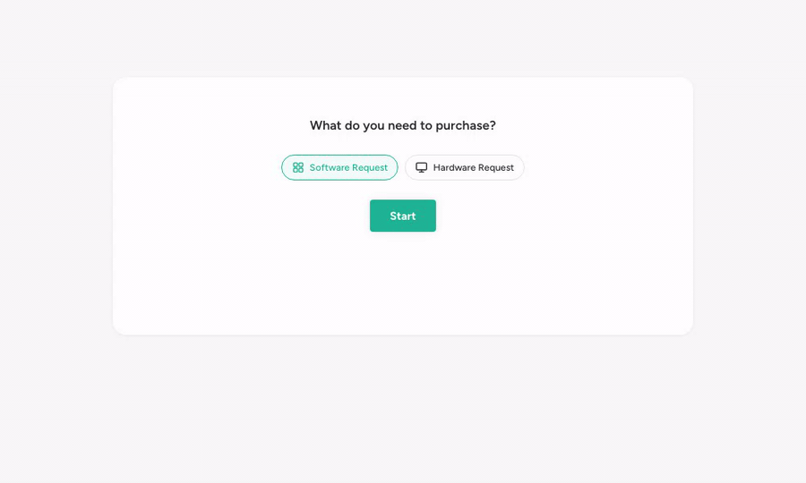
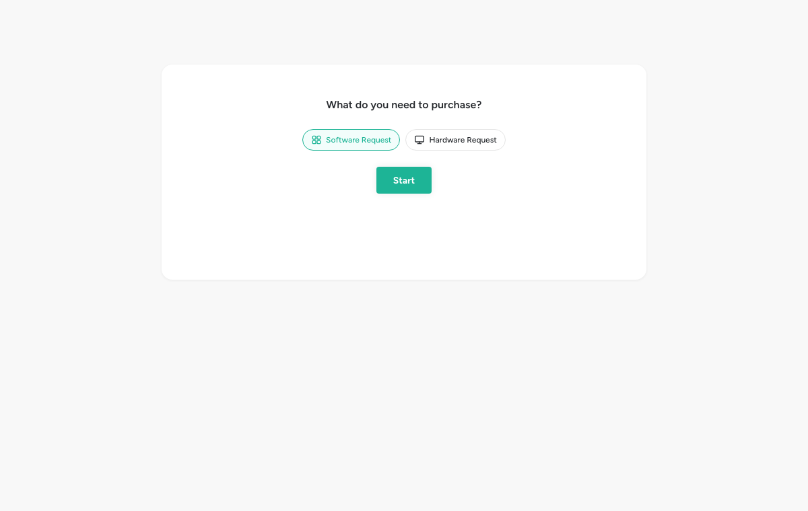
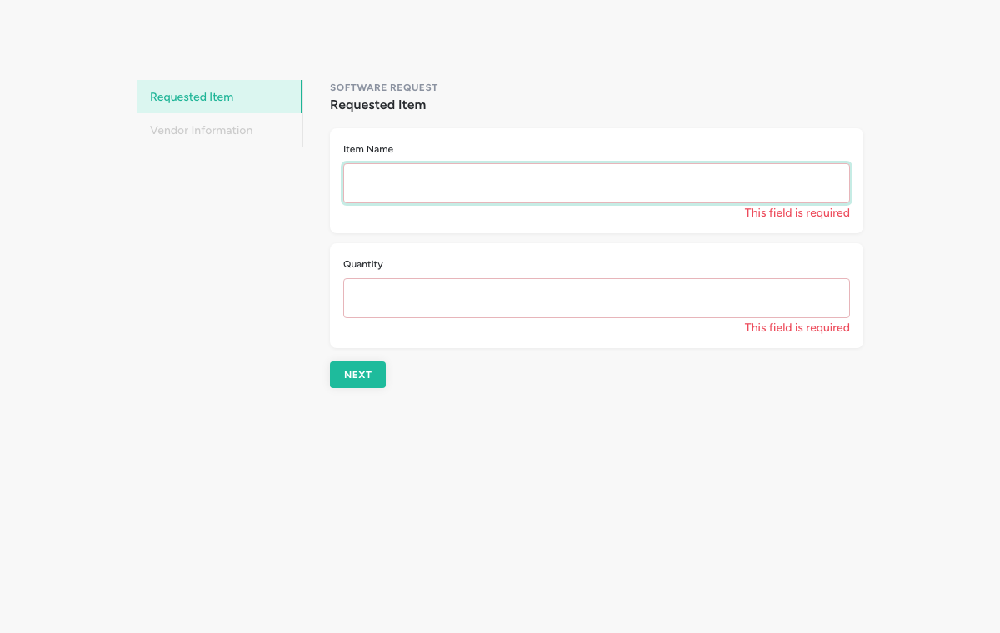
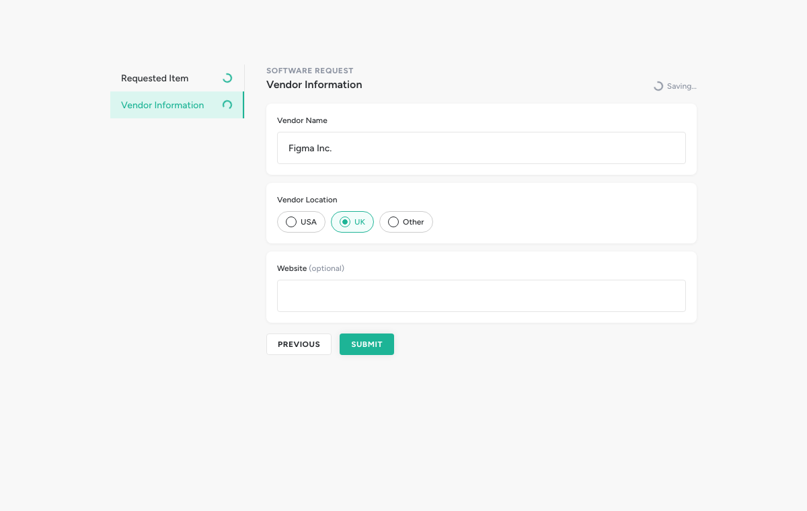
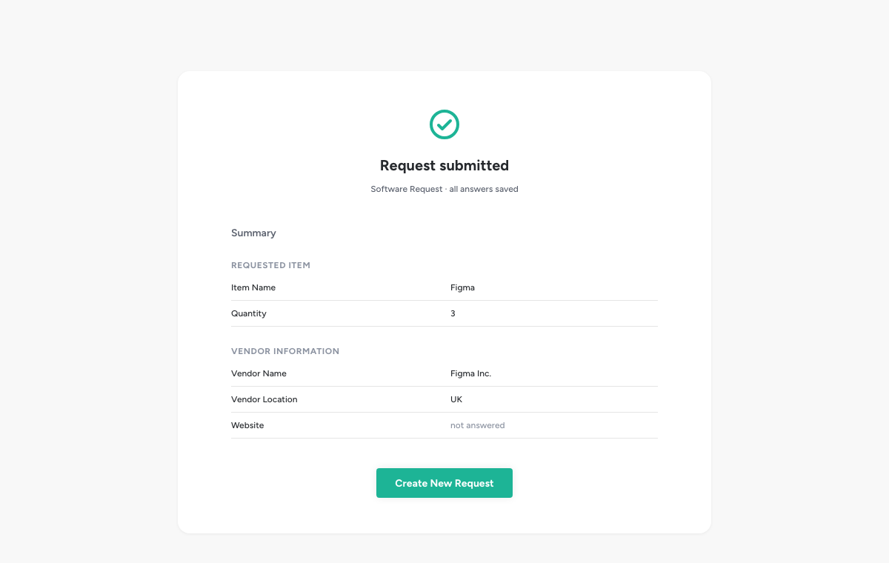
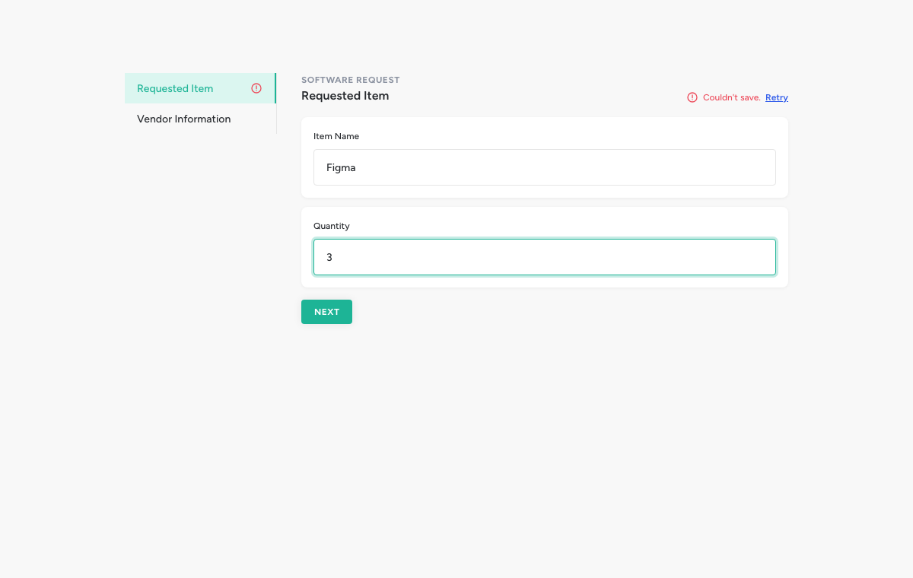

<div align="center">

# Request Wizard

**A schema-driven, multi-step request form with resilient autosave.**<br />
Built for Opstream's front-end challenge with Angular 22, Reactive Forms and RxJS.

[**Live demo →**](https://request-wizard.girao.dev)

    



</div>

## Highlights

- **Fully schema-driven.** Sections, fields, validation and defaults all come from the schema; unsupported field types are skipped instead of breaking the form.
- **Autosave that survives the real world.** One RxJS lane per question: debounce, cancellation of stale saves, retries with backoff, an explicit "gave up" state, and automatic resend when the connection comes back.
- **Nothing lost on refresh.** Drafts are restored from the (mock) server, and sections cannot be skipped through the URL while an earlier one is invalid.
- **Inputs that only accept what fits.** Number fields reject letters, signs and decimals as you type; answers are tidied when you leave a field.
- **Built on Opstream's design system.** Tokens and components mirror its names and states; every component works with the keyboard and screen readers.
- **Tested at every level.** Marble tests for the autosave pipeline, unit and component tests for everything else, and a Playwright suite that also runs against the live demo.

## Quick start

Requires Node **24** (or ≥ 22.22.3) — the Angular 22 CLI does not run on older versions. With nvm: `nvm use`.

```bash
npm ci
npm start              # http://localhost:4200
npm test               # unit + component tests (Vitest); single run: npm test -- --watch=false
npm run e2e            # end-to-end tests (Playwright); first time: npx playwright install chromium
npm run lint           # ESLint (TypeScript, templates, template accessibility)
npm run format:check   # Prettier
npm run build
```

No backend is needed: an HTTP interceptor answers `/api/*` in the browser.
CI (GitHub Actions) runs format, lint, unit tests, build and the E2E suite on every push and pull request,
and every merge to `main` is deployed to [request-wizard.girao.dev](https://request-wizard.girao.dev) (Docker + nginx).

To run the end-to-end suite against the live demo instead of a local server:
`E2E_BASE_URL=https://request-wizard.girao.dev npm run e2e`.

## Screenshots

| Choose a request type                        | Validation on Next                               |
| -------------------------------------------- | ------------------------------------------------ |
|    |  |
| **Autosave while typing**                    | **Read-only summary**                            |
|  |        |

<details>
<summary>When saving fails</summary>

After two retries the save gives up, the sidebar flags the section, and Submit is blocked until every answer is saved:



</details>

The GIF and screenshots are generated by Playwright: `npm run media` (needs `ffmpeg` for the GIF).

## Try it

| What                | How                                                                                                                                                                               |
| ------------------- | --------------------------------------------------------------------------------------------------------------------------------------------------------------------------------- |
| The happy path      | Open the [live demo](https://request-wizard.girao.dev) (or `/` locally), pick a type, fill both sections, submit.                                                                 |
| Validation          | Click **Next** with empty fields: errors appear and focus jumps to the first invalid field.                                                                                       |
| Numbers             | Type letters, `-`, `e` or `.` into **Quantity**: they never reach the field (quantities are whole).                                                                               |
| Autosave            | Type and pause: `Saving…` → `Saved`. The sidebar shows saving / done / error per section.                                                                                         |
| Refresh             | Reload in the middle of the form: answers come back from the (mock) server.                                                                                                       |
| Guarded URLs        | Paste the URL of section 2 while section 1 is invalid: you are sent back to section 1.                                                                                            |
| Save failures       | Add `?mockSaveFailureRate=1` to the URL: `Error – retrying…`, two retries, then `Couldn't save · Retry`; Submit is blocked.                                                       |
| Offline             | In DevTools, set the network to **Offline** and keep typing: the indicator says `Offline – will save when you reconnect`. Go back online: unsaved answers are sent automatically. |
| Loading failures    | Add `?mockFailureRate=1`: the chooser shows an error with **Try again**. `?mockFailureRate=0` turns random failures off.                                                          |
| Component catalogue | `/ui` renders every shared component and its states.                                                                                                                              |

The failure parameters are read when the page loads.

## Architecture in two minutes

```
src/app/
├── core/                    no UI
│   ├── models/              API shapes vs app shapes; normalizeSchema()
│   ├── api/                 SchemaApiService (cached), RequestApiService (thin HTTP)
│   ├── mock-backend/        HTTP interceptor + localStorage "database" + the brief's schemas
│   ├── forms/               validation rules: validatorsFor(field), messages, pipe
│   ├── request/             the request being filled in, shared by every page
│   │   ├── request-form.ts      schema (+ saved answers) → FormGroup
│   │   ├── section-access.ts    which sections are reachable
│   │   ├── autosave.ts          the autosave pipeline (pure function)
│   │   └── request-session.service.ts   owns form, autosave, submit, reset
│   └── utils/load-state.ts  loading / ready / error for every async boundary
├── shared/ui/               design-system components, no domain knowledge
└── features/                schema-chooser · request-wizard · request-summary · ui-playground
```

**Data flow**

```
GET /api/schemas ─► normalizeSchema() ─► buildRequestForm() ─► FormGroup (one group per section)
                    drops unsupported      validatorsFor()         │
                    types, fills defaults                          ▼ valueChanges of every field
                                                         autosave pipeline ─► PUT /api/requests/:id/question/:qid
                                                                 │
                                         per-question states ─► save indicator + sidebar status
```

**The autosave pipeline** (`core/request/autosave.ts`, ADR-0014) is a pure function, tested with marble tests:

```
changes ─ groupBy(questionId) ─┬─ every change                 → pending
                               └─ debounce 800 ms (or flush)
                                  → same as last saved? skip   → saved
                                  → switchMap(PUT)             → saving → saved
                                    5xx / network: retry ×2 (1 s, 2 s) → retrying
                                    4xx or retries exhausted   → error  (Retry action)
```

- One lane per question: answers save in parallel and never block each other.
- `switchMap`: a newer value cancels the in-flight save of the same question — safe because PUT is idempotent.
- Submit flushes pending debounces immediately and only proceeds when every answer is saved.
- Invalid values are saved too: a draft is incomplete by nature; validation gates Next/Submit, not saving.

**Who owns what.** `RequestSession` (root service) owns the active request: the chooser starts it, the wizard
edits it, the summary reads it. Keeping it out of the wizard page means a save in flight finishes even if the
user navigates away, and moving between sections never rebuilds the form.

**Styling.** Design tokens are CSS custom properties in two layers (`src/styles/_tokens.scss`): primitives named as in
Opstream's design system (`--brand-main`, `--mono-dark1`) and semantic tokens the components use
(`--color-text-primary`, `--color-border-focus`). No UI library.

## Decisions

Each decision has a short record in [`docs/adr`](docs/adr/README.md): context, what was chosen, what was rejected and why.

| Topic      | Decision                                                                      | ADR                                                      |
| ---------- | ----------------------------------------------------------------------------- | -------------------------------------------------------- |
| Stack      | Angular 22 standalone, zoneless; signals for view state, RxJS for async flows | [0002](docs/adr/0002-angular-standalone-signals-rxjs.md) |
| Structure  | Feature folders; `shared/ui` has no domain knowledge                          | [0003](docs/adr/0003-feature-based-folder-structure.md)  |
| Mock API   | `HttpInterceptor`, so services use the real `HttpClient` and contract URLs    | [0004](docs/adr/0004-mock-backend-http-interceptor.md)   |
| Form model | One `FormGroup` per request, one nested group per section                     | [0005](docs/adr/0005-single-request-form-group.md)       |
| Rendering  | `@switch` on field type; radio and toggle are `ControlValueAccessor`s         | [0006](docs/adr/0006-dynamic-field-rendering.md)         |
| Routing    | One URL per section, guarded so invalid sections cannot be skipped            | [0007](docs/adr/0007-routing-and-navigation-guard.md)    |
| Validation | Rules from schema + field type only, never from labels                        | [0013](docs/adr/0013-validation-rules-by-field-type.md)  |
| Autosave   | Per-question lanes, `switchMap`, retry, flush before submit                   | [0014](docs/adr/0014-autosave-pipeline.md)               |

## Assumptions and contract extensions

- **`GET /api/requests/:id`** was added to restore drafts after a refresh — without it, autosave would not survive a reload ([ADR-0008](docs/adr/0008-draft-restore-contract-extension.md)).
- **`schemaId` travels in the PUT body.** There is no "create request" endpoint, so the first saved answer creates the draft, and it must know its schema.
- **Request ids are generated on the client** (`crypto.randomUUID()`) when the user clicks Start. A real backend would issue them.
- **Submit is client-side**: it waits for every answer to be saved, then marks the request as submitted. A per-tab registry (`sessionStorage`) remembers that, and each request's schema, so a refresh after Start or on the summary still works.
- **Numbers are whole by default.** Both number fields in the brief are quantities; a schema may opt into decimals with an optional `decimalPlaces` property. The brief's schemas are unchanged ([ADR-0013](docs/adr/0013-validation-rules-by-field-type.md)).
- **Unsupported field types are skipped** with a console warning instead of breaking the form, as are radios without options, duplicate ids and empty sections.

## Deviations from the mockups

When the written brief and the mockups disagree, the brief wins ([ADR-0012](docs/adr/0012-written-requirements-win-over-mockups.md)).

- Only `text | number | radio | toggle` are rendered; the mockups' "Long Text" and "Dropdown" are not allowed types.
- The toggle, which has no mockup, follows Opstream's design system.
- The summary button reads **Create New Request** (brief), not "Complete the flow and Reset"; the header says "Request submitted" instead of the placeholder "Awesome! It works!".
- Chips show the schema title ("Software Request"); shortening it would mean parsing the title.
- Visual language (colours, type scale, error state, pill radios, notifications, loaders) follows the design system; the layout follows the mockups.
- The design system's font is Gilroy, which is commercial; the stack falls back to Figtree ([ADR-0011](docs/adr/0011-typography-gilroy-with-fallback.md)). A few token values could not be confirmed from the (view-only) design system and are marked `assumed` in `_tokens.scss`.

## Testing

- **Unit:** schema normalisation, validators, form factory, section access, mock backend (latency, failures, validation, persistence), API services, request session, number input parsing.
- **Marble tests** for the autosave pipeline: debounce, cancellation, retry then success, retries exhausted, no retry on 4xx, flush, unchanged values, parallel questions.
- **Components:** every `shared/ui` component, including both `ControlValueAccessor`s.
- **Pages** run through `RouterTestingHarness` with the real routes, guards and session; only HTTP is faked.
- **End-to-end (Playwright, Chromium):** the full flow, validation and focus, numeric input, refresh, guarded
  sections, submit and summary, the phone layout, and the failure paths (schema load error, autosave giving up
  and blocking submit, offline answers saved on reconnect). Deterministic: random failures are switched off per
  test with `?mockFailureRate=0` and forced with `?mockSaveFailureRate=1`.

## Accessibility

Labels bound to every control (`fieldset`/`legend` for radio groups), `aria-invalid` and `aria-describedby` on errors,
focus moved to the first invalid field on Next and to the section heading after navigating, native radios (arrow keys)
and a native checkbox with `role="switch"`, the save status in a polite live region, `aria-current="step"` in the sidebar,
visible focus rings and reduced motion support.

## How I used AI

The brief allows AI, so here is exactly how it was used. I worked with Claude Code as a pair: it drafted,
I decided and reviewed. Nothing went into a commit that I could not explain line by line.

**Where it helped most**

- **Getting oriented fast:** summarising the brief and researching Opstream's product before writing code.
- **Turning screenshots into specs:** the Figma files were view-only, so the mockups were rebuilt in a working Figma
  file from screenshots, and the design-system tokens were transcribed from screenshots into `_tokens.scss`.
- **Design before code:** decisions were discussed one at a time (validation strategy, saving invalid values,
  where the autosave lives) and recorded as ADRs before implementation.
- **Tests:** drafting marble tests for the autosave pipeline, specs for every component and the Playwright
  suite that checks, in a real browser, what unit tests cannot.

**Where I had to push back**

- **Number input.** The first version used `<input type="number">` and documented that "1e" is reported as empty
  as a known limitation. That is not acceptable for a quantity: I required that number fields never accept text,
  which led to the `uiNumberInput` directive.
- **Whole numbers.** The first version also allowed decimals. Quantities are whole, but inferring that from the
  label would break the schema-driven design, so numbers became whole by default with an optional
  `decimalPlaces` in the schema ([ADR-0013](docs/adr/0013-validation-rules-by-field-type.md)).
- **Verification over trust.** Generated code was not taken as correct until tests and a real browser agreed:
  that caught a miscounted marble diagram in a test, disabled buttons that were invisible on the page background,
  and the wrong active-tab marker on mobile.

**What I kept for myself:** the scope, every trade-off in the ADRs, and the final review of each commit.

## Known limitations

- Answers saved for a request are never deleted from the mock database (it lives in `localStorage`).
- A request started in one tab cannot be reopened from another tab before its first answer is saved (the registry is per tab).
- A cancelled save (newer value) is dropped by the mock before it is written; a real server could still apply it. The next save carries the latest value, so the end state is the same.

## With more time

- **Cross-browser E2E** (Firefox, WebKit) and visual regression on the screenshots.
- **Storybook** for `shared/ui`, replacing the `/ui` catalogue.
- **More schema-driven rules** (`min`, `max`, `pattern`) read by `validatorsFor`.
- A **component registry** for field types instead of `@switch`, once there are more than a handful.
- **Dark mode:** the semantic token layer makes it a matter of redefining tokens per theme, but the design system has no dark palette yet, so it would mean inventing colours.
- **i18n** of messages (`validation-messages.ts` would become an `InjectionToken`).
- A real **submit endpoint** and server-side validation.
